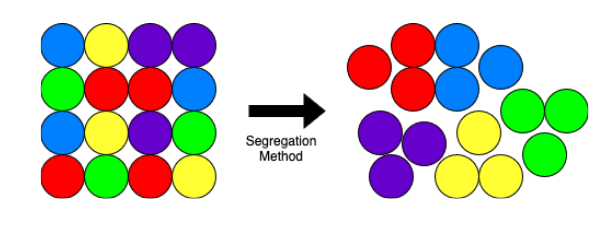
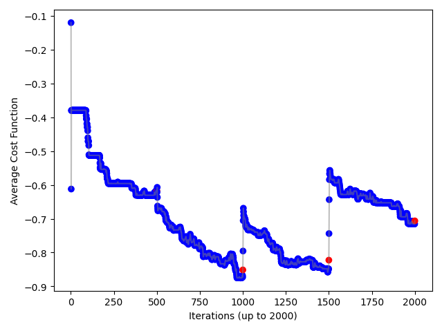
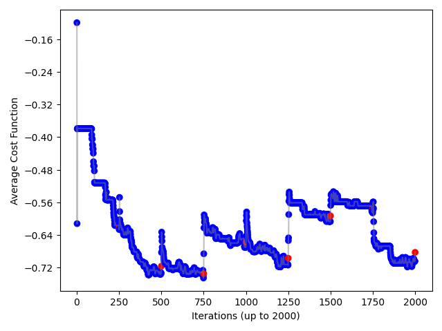
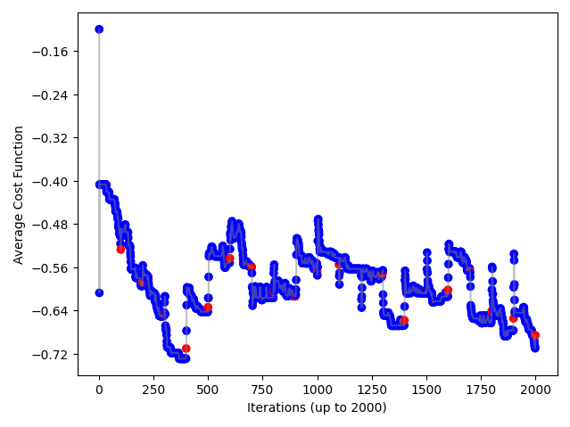
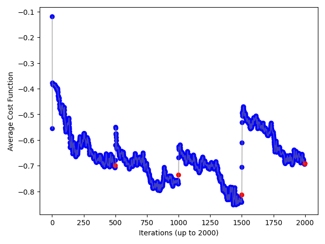
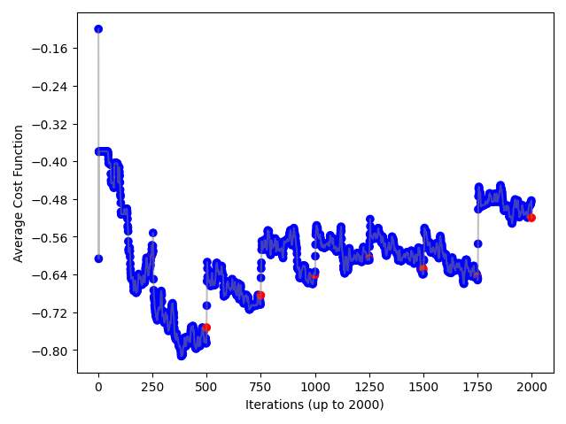
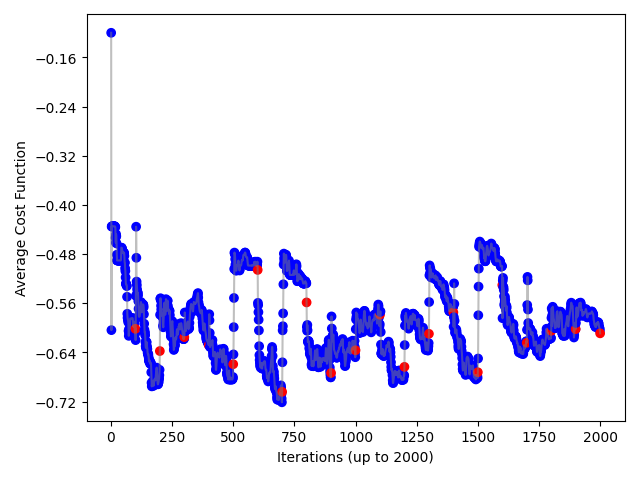
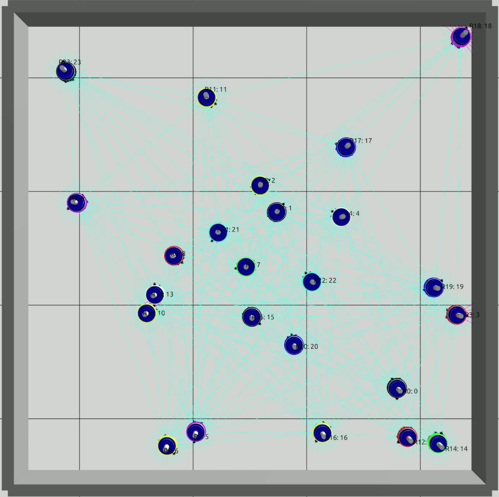
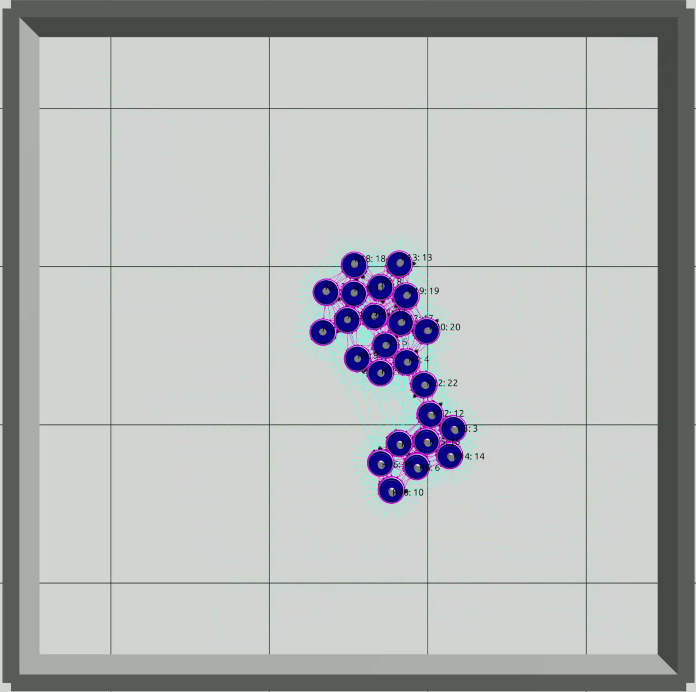

# Dynamic Color Changes in Minimalistic Robot Swarm Segregation

A swarm-robotics study that extends the minimalistic segregation model of Mitrano et al., *"A Minimalistic Approach to Segregation in Robot Swarms"* (MRS 2019), to the case where the attribute the robots segregate by, their **color**, **changes over time**. Four color-changing strategies are implemented in **Buzz** and simulated in **ARGoS** with a swarm of 24 robots. The study measures how well segregation holds up and recovers after each change, and what the swarm converges to when robots adopt their neighbors' colors.

This project was done as part of the final project for the RBE 511: Swarm Intelligence course at WPI. Team project (3 members).

<p align="center">
  
</p>

---

## Background: the baseline segregation controller

In the original model, each robot has only a **ternary sensor** that looks straight ahead and reports one of three things about the closest robot in its line of sight:

- **Nothing in sight:** the robot turns to search.
- **A robot of the same color:** it moves toward it to stay with its kin.
- **A robot of a different color:** it turns away.

Each reading maps directly to a pair of wheel speeds. There is no global communication, planning or computation, yet robots of the same color end up grouped together.

**Measuring segregation.** Segregation is scored with the cost function from the original paper:

- **Per color:** find the largest group of robots of that color that are clustered together, and divide its size by the total number of robots of that color.
- **Whole swarm:** average this over all the colors and make it negative, giving a single score `γ(t)` at every time step.
- **Reading the score:** `γ` closer to **−1** means more segregated (every color in one group), and closer to **0** means more mixed. A color change makes `γ` jump up toward 0, and good recovery means it falls back toward −1.
- **How it's computed:** each robot gets its position from a positioning sensor and shares it with its color through **virtual stigmergy**, so the swarm computes the score itself while running.

---

## Color-changing strategies

Real agents' properties change over time, so this project changes the robots' colors **during** the simulation. The wheel speeds stay fixed at the optimal values from the original paper, so the effect of each strategy and its parameters can be isolated.

| # | Strategy | File | How it works | Parameters tested |
|---|----------|------|--------------|-------------------|
| 1 | **Random** | `FP2_Random.bzz` | Every *N* steps, each robot switches to a randomly chosen color. | Switch every 100, 250 or 500 steps |
| 2 | **Fixed cycle** | `FP2_Fixed_Cycles.bzz` | Each robot gets its own randomly ordered list of colors and moves to the next one every *N* steps. | Switch every 100, 250 or 500 steps |
| 3 | **Majority (Schelling-inspired)** | `FP2_Schelling_Model.bzz` | At each step, a robot checks what fraction of its neighbors have each color. If any color's fraction is above a threshold, it switches to that color. | Threshold 0.3, 0.5, 0.65, 0.7 |
| 4 | **Grayscale** | `FP2_Grayscale.bzz` | Robots step through 8 shades of gray, from black to white and back, following their own sine-based schedule. | Shade changes every 10, 20 or 100 steps |

**Setup:** 24 foot-bots across 8 colors in a walled ARGoS arena, run for 2000 steps. The random and fixed-cycle runs were each repeated 5 times per setting, and the plots below are averaged over those runs.

---

## Results

### Random and fixed-cycle switching

In the plots, red points mark color switches.

- **Each switch breaks segregation.** The cost jumps up right after a color change, then gradually comes back down as robots find their new kin.
- **Slower switching recovers better.** Switching every 250 or 500 steps gives the swarm time to re-segregate. Switching every 100 steps doesn't give it enough time, so the cost never fully recovers.
- **Recovery gets harder later in a run.** As clusters become tightly packed, robots block each other's line of sight, so a robot surrounded by other colors struggles to spot its kin.
- **Fixed cycles recover more slowly than random switching.** A robot can't return to a color until it has gone through its whole list, so it is less likely to land on a color that its neighbors already have.

<table>
  <tr>
    <th></th>
    <th>Every 500 steps</th>
    <th>Every 250 steps</th>
    <th>Every 100 steps</th>
  </tr>
  <tr>
    <td><b>Random</b></td>
    <td></td>
    <td></td>
    <td></td>
  </tr>
  <tr>
    <td><b>Fixed cycle</b></td>
    <td></td>
    <td></td>
    <td></td>
  </tr>
</table>

The videos below show one run of each strategy with colors switching every 500 steps (played at 2x speed). After each switch, the clusters break apart as robots suddenly see a different color, and then gradually reform around the new colors.

<table>
  <tr>
    <td align="center" valign="top" width="50%"><video src="https://github.com/user-attachments/assets/6d789b5b-c427-4b16-8795-b31cb1396222" controls></video><br><em>Random, every 500 steps (2x speed)</em></td>
    <td align="center" valign="top" width="50%"><video src="https://github.com/user-attachments/assets/ff2a13b5-058c-45d5-a866-2ea51c520e75" controls></video><br><em>Fixed cycle, every 500 steps (2x speed)</em></td>
  </tr>
</table>

### Majority switching (Schelling-inspired)

Here the question is whether, and to which color, the swarm converges.

- **Threshold up to 0.65:** all robots always end up with the same color, which is the color most robots started with. Low thresholds (0.3) converge very quickly, and higher ones (0.65) more slowly.
- **Threshold 0.7:** convergence is no longer guaranteed, and the swarm often splits into several color groups.
- **Threshold 0.5 is a critical point:** robots still converge to a single color, but **not necessarily the initial majority**. The outcome depends on whether the majority-colored robots start clustered or spread out, and on how many of them each robot can see at a time. This makes the result hard to predict.

The two runs below show the typical behavior and the exception:

<table>
  <tr>
    <td align="center" valign="top" width="50%"><video src="https://github.com/user-attachments/assets/01641099-677b-492b-a8aa-41489e0416df" controls></video><br><em>Threshold 0.65: robots gradually adopt the color most of them started with, and the whole swarm ends up one color.</em></td>
    <td align="center" valign="top" width="50%"><video src="https://github.com/user-attachments/assets/2164f0f1-7d21-4912-9824-51bddcd60331" controls></video><br><em>Threshold 0.5: the swarm still ends up one color, but not the starting majority.</em></td>
  </tr>
</table>

In the threshold 0.5 run, yellow starts as the majority color (5 robots), but the swarm converges to pink:

<table align="center">
  <tr>
    <td align="center"><br><em>Initial colors</em></td>
    <td align="center"><br><em>Final converged state</em></td>
  </tr>
</table>

### Grayscale

Behavior was similar to the random and fixed-cycle strategies. Contrary to what we expected, no distinct patterns emerged.

---

## Future work

- **Random switching:** relate the randomness of color switching to the noise seen in real swarms, to test how far minimalist segregation scales in practice.
- **Majority switching:** study how the initial spatial distribution of colors affects the outcome, especially at threshold 0.5. Try a deterministic rule in place of the probabilistic one, for example switching based on the number of neighbors.
- **Grayscale:** let robots influence each other's shade, to explore synchronization within segregation.

---

## Repository structure

| Path | Description |
|------|-------------|
| `FP2.argos` | ARGoS experiment: 24 foot-bots in a walled arena, 10 ticks per second, using the Buzz foot-bot controller. |
| `FP2.bzz` | Baseline segregation controller with fixed colors (ternary sensor, no color changes). |
| `FP2_Random.bzz` | Strategy 1: random color switching. |
| `FP2_Fixed_Cycles.bzz`, `FP2_Fixed_Cycles_new.bzz` | Strategy 2: fixed-cycle switching (two parameter variants). |
| `FP2_Schelling_Model.bzz` | Strategy 3: majority switching. |
| `FP2_Grayscale.bzz` | Strategy 4: grayscale switching. |
| `SchellingModelData1/` | Logged cost data (`.txt`) and screen recordings (`.webm`) of the majority runs for thresholds 0.3, 0.5, 0.65 and 0.7. |

---

## Stack

`Swarm robotics` · `Buzz` · `ARGoS` · `Virtual stigmergy` · `Foot-bot`

---

## Running it

Requires [ARGoS 3](https://www.argos-sim.info/) with [Buzz](https://github.com/buzz-lang/Buzz) installed.

```bash
export BUZZ_INCLUDE_PATH=/usr/local/share/buzz/include   # for vec2.bzz and other Buzz includes
argos3 -c FP2.argos
```

In the ARGoS window, open the strategy's `.bzz` script in the Buzz editor, then compile and run it. Each script's parameters are set near the top of the file: `switchFreq` (steps between color changes), `aggTime` (settling time before switching starts), and `sm_threshold` for the majority strategy.

---

## My contributions

This was a team project with three members. My contributions were:

- **Random and fixed-cycle strategies:** implemented both color-switching strategies.
- **Majority strategy:** worked on the Schelling-inspired majority switching.
- **Analysis:** ran the switching-frequency and threshold experiments, and interpreted the corresponding results.
---

## Acknowledgements

- Baseline model: P. Mitrano, J. Burklund, M. Giancola and C. Pinciroli, *"A Minimalistic Approach to Segregation in Robot Swarms,"* International Symposium on Multi-Robot and Multi-Agent Systems (MRS), 2019.
- Built with [ARGoS](https://www.argos-sim.info/) and [Buzz](https://github.com/buzz-lang/Buzz).
